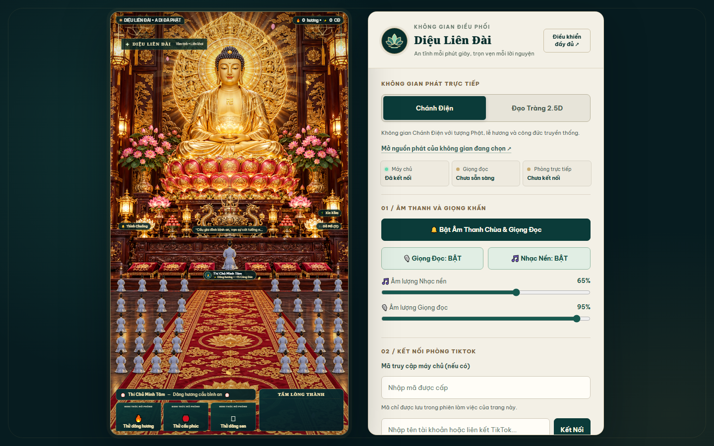
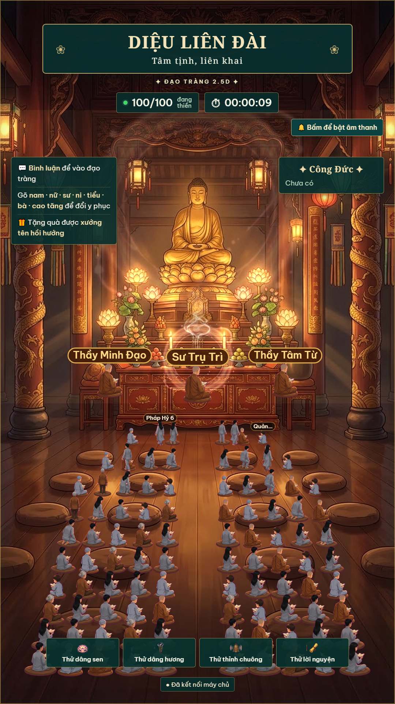

# Diệu Liên Đài (妙蓮臺)

**Không gian thiền viện tương tác dành cho phát trực tiếp, với hai khung cảnh dọc và giọng đọc tiếng Việt.**

Diệu Liên Đài là phiên bản phát triển và mang nhận diện riêng từ hai dự án tham khảo. Chương trình có bảng điều khiển, khu vực tương tác cho người xem, nghi thức dâng hương, bảng công đức, nhận bình luận và quà tặng theo sự kiện TikTok. Hai không gian sử dụng chung một máy chủ để tránh nhân đôi các sự kiện.

**Ý nghĩa tên:** *Diệu* (妙) là nhiệm màu, tốt đẹp; *Liên* (蓮) là hoa sen; *Đài* (臺) là đài, bệ tòa. Trong từ điển Phật học, *Liên đài* là tòa sen của chư Phật và Bồ Tát, còn *Diệu liên hoa* biểu trưng cho trí tuệ thanh tịnh. Tên thương hiệu này được ghép với ý nghĩa **“tòa sen nhiệm màu, biểu trưng cho trí tuệ và sự thanh tịnh”**. Đây là tên sáng tạo từ các thuật ngữ đã có, không tự nhận là tên một ngôi chùa hay danh xưng kinh điển.

Tham khảo: [Từ điển Phật học về Diệu liên hoa](https://phatgiao.org.vn/tu-dien-phat-hoc-online/dieu-lien-hoa-k49896.html) và [Từ điển Phật học Tuệ Quang về Liên đài](https://www.thuvienhoasen.org/a24896/li).

> **Lưu ý bản quyền trước khi công khai:** Phần mã nguồn kế thừa từ `zane-tv/tiktok-live-temple-rpc` chưa xác định được giấy phép tái phân phối; hình ảnh và nhạc cũng cần xác minh quyền sử dụng. Bản hiện tại phù hợp để lưu trong **kho riêng tư** trước khi hoàn tất việc xin phép hoặc thay thế các thành phần chưa rõ quyền. Xem [ghi chú nguồn gốc và quyền sử dụng](docs/NGUON-GOC-VA-BAN-QUYEN.md).

## Hai khung cảnh

| Không gian | Đặc điểm |
| --- | --- |
| Chánh Điện | Tượng Phật A Di Đà, dâng hương, đảnh lễ, chuông, mõ, hoa đăng, xin xăm và bảng công đức |
| Đạo Tràng 2,5 chiều | Nhân vật đi vào ngồi thiền, tự mở rộng 24/36/64/100 chỗ, đổi y phục bằng bình luận, hiệu ứng quà |

### Hình ảnh





## Cài đặt

Cần **Node.js 20 trở lên**. Để sử dụng giọng đọc tiếng Việt, cần thêm Python 3.11 và công cụ `uv`.

Trên Windows:

1. Chạy `CAI-DAT.bat` để cài thư viện và tải mô hình giọng đọc lần đầu.
2. Chạy `CHAY-DIEU-LIEN-DAI.bat` để mở máy chủ.
3. Truy cập `http://127.0.0.1:3000` trong trình duyệt để điều khiển.
4. Chỉ bấm **Kết nối TikTok** khi có phòng phát trực tiếp cần nhận sự kiện.

Cài thủ công:

```powershell
npm ci
npm start
```

Muốn sử dụng giọng đọc:

```powershell
uv venv --python 3.11 .venv
uv pip install --python .venv/Scripts/python.exe zerotts pillow
.venv/Scripts/python.exe tools/chuan-bi-mo-hinh.py
```

Mô hình âm thanh không được tải lên kho mã nguồn. Lần cài đầu tiên phải tải dữ liệu riêng.

## Địa chỉ sử dụng

| Chức năng | Đường dẫn |
| --- | --- |
| Bảng điều khiển | `http://127.0.0.1:3000` |
| Nguồn phát Chánh Điện | `http://127.0.0.1:3000/?obs=1` |
| Nguồn phát Đạo Tràng | `http://127.0.0.1:3000/?obs=1&scene=dao` |
| Quản trị | `http://127.0.0.1:3000/admin` |

Đặt khung trình duyệt trong phần mềm phát trực tiếp ở kích thước **1080 × 1920**.

## Chức năng và kiểm thử

- Nhận sự kiện phòng TikTok bằng thư viện cộng đồng không chính thức.
- Hai cảnh sử dụng chung sự kiện và bộ xử lý quà liên tục, tránh tính trùng.
- Bảng công đức riêng, có giới hạn đầu vào và lưu an toàn.
- Giọng đọc tiếng Việt ZeroTTS chạy trên máy cá nhân, có bộ đệm âm thanh.
- Mô phỏng người xem và quà để kiểm tra hình ảnh, không cộng vào công đức thật.
- Mặc định chỉ mở máy chủ ở `127.0.0.1`, có thể bổ sung mã truy cập nếu cấu hình kết nối bên ngoài.

Chạy các phép thử:

```powershell
npm test
```

Kiểm thử giao diện với trình duyệt không hiển thị khi đã cài Playwright dành cho Python:

```powershell
python tools/qa-ui-thiet-ke.py
```

## Bảo vệ dữ liệu

Tệp điểm công đức, tệp âm thanh đã tổng hợp, mô hình giọng đọc và thông tin riêng không nằm trong kho mã nguồn. Khi chạy, chương trình tự tạo dữ liệu tại thư mục `data/`.

Không công khai cổng điều khiển trực tiếp lên mạng. Không đặt mã truy cập hoặc thông tin cá nhân trong mã nguồn. Xem [hướng dẫn bảo vệ](docs/AN-TOAN-TRIEN-KHAI.md).

## Nguồn gốc và đóng góp

Đây là **dự án phát triển phái sinh**, không tuyên bố toàn bộ mã nguồn, ảnh và âm thanh được sáng tạo mới từ đầu. Nền tảng tham khảo gồm [zane-tv/tiktok-live-temple-rpc](https://github.com/zane-tv/tiktok-live-temple-rpc) và [kentjuno/chanh-dien-online](https://github.com/kentjuno/chanh-dien-online). Giấy phép MIT của dự án thứ hai được lưu nguyên tại `docs/GIAY-PHEP-KENTJUNO.txt`.

Xem [thuyết minh quyền sử dụng](docs/NGUON-GOC-VA-BAN-QUYEN.md) và [quy chuẩn thiết kế](docs/HE-THONG-THIET-KE.md).

Để tạo kho riêng tư và đưa mã lên GitHub, xem [hướng dẫn xuất bản](docs/DUA-LEN-GITHUB.md).
